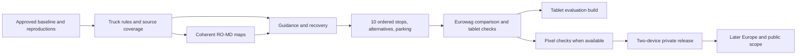

# EuroRig truck-navigation roadmap

27 October handover: A1–A4 and B1–B3 are accepted: **7/37 packages (18.9%)** after reconciling prerequisites. C1, C2, C4, D5, D6 and E1 have passing technical evidence but remain partial until their required upstream packages are accepted. E2 has passing local gates but remains partial. See the [whole-project handover](docs/HANDOVER-CLAUDE-2026-10-27.md) and [current progress](docs/planning/progress/codex.json). This is an equal-weight package count, not an estimate of work or safety coverage.

Historical 25 October checkpoint: approved interface origin `6531ad5`, followed by UI checkpoint `65f3104` and [correctness fixes](docs/CORRECTNESS-2026-10-25.md). Navigation is not complete.

Execution is split into [Codex: decisions, implementation and acceptance](docs/planning/CODEX_WORK.md) and [DeepSeek: bulk preparation and one-go handoff](docs/planning/DEEPSEEK_WORK.md). [Live progress](docs/planning/LIVE_PROGRESS.md) shows both lanes, current work, blockers and the accepted-package percentage. All 37 packages and their dependencies below remain authoritative.

[DeepSeek round two](docs/planning/DEEPSEEK_ROUND2.md) reported eight submitted preparation batches. Submission is not product acceptance; review each candidate and its evidence before integration.

## 1. Confirmed owner requirements

| Decision | First-release scope |
| --- | --- |
| Users | The owner only; public distribution later. |
| Countries | Romania and Moldova, including tested cross-border journeys. Longer-term target: Europe excluding Russia. |
| Trucks | All standard legal combinations and ADR profiles. Individually permitted oversized/overweight abnormal loads come later. |
| Required features | Reliable guidance/rerouting, truck restrictions, multiple stops, route alternatives and parking. |
| Stops | **10 intermediate stops**, plus origin/destination. Always follow chosen order; support manual **drag-and-drop reordering** during planning. No automatic order optimization. |
| Country route preferences | Save settings separately for each country, with the same option definitions in every section. Clearly identify unavailable data. |
| Tolls and traffic | Include where trustworthy free data exist; otherwise clearly show unavailable or partial coverage. They do not block the first private build. |
| Connectivity | Offline core after maps/voices are installed. Online extras optional. |
| Devices | Samsung Galaxy Tab S9 and Pixel 8 Pro. Tablet available; Pixel not currently available for physical tests. |
| Languages | Romanian and English, interface and spoken guidance. |
| Restart | Restore the trip, obtain fresh GPS, recheck profile/permissions, then ask the driver to resume. |
| Schedule/cost | No fixed deadline; free data only; zero recurring hosting spend initially; manual imports acceptable. Free app without subscriptions. |
| Validation | Codex performs automated, emulator and available-device tests and compares with the existing authorized Eurowag installation. No driver test program is available. |
| Interface | Preserve the approved MapLibre interface; do not return to old main's UI. |

“All standard legal combinations and ADR profiles” is required scope, not an existing capability claim. Every unsupported combination must be visible. Never silently substitute smaller dimensions, ordinary cargo or car routing.

## 2. Current state: implementation versus proof

| Area | Evidence available | Remaining proof/work |
| --- | --- | --- |
| Build | Historical checkpoints include routing/tooling tests and Preview APK builds. Latest focused E1/E2 gates and their limits are recorded in the [handover](docs/HANDOVER-CLAUDE-2026-10-27.md). | Re-run the relevant checks on the exact checkout and environment. Build success does not establish legal coverage or road validation. |
| Interface/maps | Isolated EuroRig Preview runs the approved MapLibre baseline with the referenced native stop editor/country options; tablet and compact layouts checked. Original app/maps preserved. | Complete journey reliability on both target devices. |
| Coverage | Published catalog contains Romania; recovered RO–MD packages and a CESTRIN-enriched variant have verified backup hashes. | Current legal/restriction coverage, Moldova completeness and border routing. |
| Truck routing | Native truck costing, per-road audit, permission lifetime and endpoint checks exist. Malformed active preferences block planning/guidance until review. [Named-profile persistence](docs/PROFILE-PERSISTENCE-2026-10-25.md) now rejects malformed values/truncation and preserves readable siblings and hazardous-load meaning. [Capability matrix and limits](docs/TRUCK-CAPABILITIES.md) are explicit. | Complete combination/ADR support. Truck represents up to 200 t; NativeRouter refuses above 100 t without clamping. These are code limits, not legal limits. Trailer/axle-group structure and full consignment semantics are absent. |
| ADR detour | Current native profile/ADR suite passes, including the category-C fixture that failed historically. | Complete consignment/profile matrix and independent legal-corridor comparison; one fixture does not establish ADR completeness. |
| Guidance | Foreground GPS, stale-fix warnings, rerouting, waypoint progress and offline voice selection exist. | Complex-junction matching, robust recovery and actual speech on both devices. |
| Stops | Ten intermediate stops, native drag-and-drop, in-place replacement and chosen-order persistence pass. Remaining-stop rerouting passes. Identical consecutive origin/destination stops retain separate boundaries without fictitious native legs; native fixtures and the previously failing saved-trip regression pass. | Broader lifecycle/recovery, crossed/duplicate-stop and long-trip cases on both devices. |
| Alternatives | Planner offers a primary route and up to two distinct audited candidates from bounded seed exclusions; real selection/map alternatives verified. | Corridor breadth, performance and multi-stop alternatives; no k-shortest optimality claim. |
| Country options | Identical country-keyed option definitions; edge admin metadata applies preferences independently. Missing metadata is refused. | Verified congestion zones remain unavailable; municipal source coverage remains incomplete. |
| Lanes/parking | Lane metadata/view, parking UI/access checks/cache and NDW adapter exist. | Lane correctness/completeness and relevant RO–MD parking/occupancy coverage. |
| Device proof | Current tablet UI-routing, profiles/ADR, overlay, simulator/interface, browsing and remaining-stop reroute suites pass. Compact layout overrides restored afterward. | Full navigation/GPS/parking/import matrix, Pixel hardware and actual driving validation. |

Source anchors: [NativeRouter](app/src/main/java/org/eurorig/app/NativeRouter.java), [NavigationService](app/src/main/java/org/eurorig/app/NavigationService.java), [JourneyUi](app/src/main/java/org/eurorig/app/JourneyUi.java), [AccessPolicy](routing/src/main/java/org/eurorig/routing/AccessPolicy.java), [Truck](routing/src/main/java/org/eurorig/routing/Truck.java), [native verification](docs/NATIVE-INTERFACE-VERIFICATION.md), [continuation](CONTINUATION.md).

Older documents describe their recorded builds. Source presence proves implementation exists; current test evidence determines what may be called verified.

### Package status at this checkpoint

| Packages | Status | What remains before closure |
| --- | --- | --- |
| A4 | Verified for the current tablet build | Separate preview identity/storage, checked-in build recipe and preserved original app/maps are established. This does not close device qualification. |
| A1–A2 | Accepted | Source/maps/settings restoration and bound receipts verified; six-suite native inventory passes with failure history and coverage limits preserved. |
| A3 | Accepted | Genuine SDK36 cold Windows build, both APKs, 212 routing and 135 tooling tests pass; hosted Windows/Ubuntu jobs pass. Current 85-warning triage is explicit. |
| B1 | Accepted capability matrix and eligibility contract | Fields/configurations are classified; shared native eligibility and preservation pass. Explicit unsupported combination/ADR rows still prevent claiming full truck support. |
| B2 | Accepted synthetic ADR detour regression | Independently specified corridor passes72cases across every mode/delivery state; full consignment semantics and real-road legal coverage remain unclaimed. |
| B3 | Accepted supported hard-rule software matrix | Imported node/via-way no/only history, modes, joins and uncertainty pass bound fixtures and review. Unsupported geometry/conditional/trailer semantics and conservative search limits remain explicit; country maps still need rebuilding. |
| B4–B6 | Open foundations, with existing enforcement and passing fixtures | Finish access lifetime, source register and conditional/municipal coverage. Rendering tests do not close missing data. |
| C1–C4 | Partial | Recovered routing/display/detail maps are usable and backed up. Coherent RO–MD border evidence, source manifests and complete update/distribution qualification remain. |
| D1–D6 | Partial | Available-device smoke/replay evidence exists. Complex matching, failure/recovery, confirmed restart and complete RO/EN speech/UI remain. |
| E1 | Partial; technical gates pass | The local 5/5 gates cover ordered stops, editor, duplicate boundaries and process death. B4, D2 and C3 prerequisites remain open; reordering evidence uses co-located stops, so broader distinct-stop reordering remains to prove. The disconnected seam is refused. |
| E2 | Partial; local gates pass | Two-point candidates are audited, deduplicated, capped and presented with distance, ETA and restriction status. B4/C1 prerequisites and an independent native single-lawful-route case remain open. |
| E3 | Open | Ordered multi-stop alternatives need separate implementation and whole-trip acceptance. |
| E4–E7 | Partial infrastructure; coverage unproved | Static RO–MD parking needs validation. Occupancy, toll and traffic coverage are conditional; absence must stay explicit. |
| F1–F5 | Partial available-tablet evidence | The formal matched-profile Eurowag corpus, qualification/soak work and physical Pixel checks remain. No road validation exists. |
| G1–G5 | Not accepted; expansion remains later scope | Release prerequisites remain open. No private-release, Europe-wide or public-readiness claim is made. |

The UI/routing task closed seven acceptance gates and handed off one unresolved municipal-data gate. Those eight task gates are not the 37 roadmap packages and do not imply a project completion percentage.

## 3. How work is accepted

- **P0:** blocks a guidance candidate or an applicable truck-safety enforcement claim.
- **P1:** required for the owner's agreed private feature set.
- **P2:** conditional online enrichment, honestly unavailable where unsupported.
- **P3:** later countries, public release and extended capabilities.

Each package below has a deliverable, dependency and observable pass condition. Completion requires evidence tied to source, APK, map, device and profile versions. An unresolved failure remains open; adding tests or documenting it is not a pass.

Codex owns design, implementation, independent acceptance and automated/stationary device verification. DeepSeek owns the twelve bulk-preparation batches in its linked plan. The owner supplies decisions and device access. Authorities/publishers control missing data and reuse rights. The first completion label is **automated/device-verified private build**. Under agent-only testing, **road validation remains not performed**.

## 4. Implementation work packages

### Phase A — approved baseline and reproducible failures

| ID | Priority / prerequisites | Deliverable and acceptance |
| --- | --- | --- |
| A1 | P0 / none | Preserve approved source, recovered maps, signatures and profile/settings snapshots. Every test receipt identifies commit, APK/map hashes, device/OS and truck inputs. Restore/recovery remains possible. |
| A2 | P0 / A1 | Run current native profile/ADR, navigation, GPS, interface, parking and import suites. Reproduce the historical ADR-C case first. Record individual outcomes and isolated reproductions; an incomplete suite cannot be called passing. |
| A3 | P0 / A1 | Prove a fresh-checkout Windows/CI build without hidden fixtures or skipped tooling tests. Reconcile compile-SDK and CI provisioning; classify lint warnings and fix correctness/platform issues. Keep source/dependency versions explicit. |
| A4 | P0 / A1 | Create a clearly labeled isolated QA build of the approved interface with separate IDs/storage. Verify UI identity. Preserve original EuroRig/Eurowag data; physical devices never run data-clearing smoke scripts. |

Exit: current failure inventory, reproducible receipts and isolated device testing. No UI redesign or engine migration is required.

### Phase B — truck rules, access and data foundations

| ID | Priority / prerequisites | Deliverable and acceptance |
| --- | --- | --- |
| B1 | P0 / A2 | Create the complete standard-truck/ADR capability matrix: rigid, tractor/semitrailer, drawbar, trailer configuration, total dimensions, loaded/permitted mass, axle loads/counts and cargo/tunnel inputs. Map each field to engine enforcement, added audit or explicit unsupported status. Test boundary/equality/contradictory inputs; close the 200 t/100 t mismatch without inventing support. |
| B2 | P0 / A2, B1 | Resolve any reproduced ADR legal-detour failures. Keep prohibited edges excluded; independently verify the expected corridor. Cover expensive legal approaches, endpoint changes and every routing preference. Find a verified legal detour or establish why the expectation is invalid; never relax a hard restriction for a pass. |
| B3 | P0 / B1 | Verify imported/native/audited node and via-way turns, no/only rules, multiple via ways, direction, access hierarchy, dimensions, gross/axle loads and trailers. Use actual path-history fixtures and conflicting/unknown cases. All preferences, alternatives and reroutes enforce identical hard rules. |
| B4 | P0 / B1, B3 | Verify private/delivery/final-approach permissions through stops, expiry, revocation, profile changes and reroutes. Intermediate stops never grant trip-wide permission. Routing and restricted-road paint agree; stale authorization cannot remain valid during GPS loss. |
| B5 | P0 / A1, B1 | Build the reusable bulk-source pipeline described in section 7: one shared rule model, adapters by source format, country configuration, dated provenance, exact road/zone matching and an exception queue. Audit national and municipal coverage automatically. Maintain the RO/MD source register; proposals, expired notices and ambiguous matches are not current restrictions. Manual city-by-city compilation is not the delivery strategy. |
| B6 | P0 / B3, B5 | Add/verify timezone/admin support and scheduled/conditional restrictions, applicable holidays, access zones, exemptions and country/load rules. Validate dated authoritative fixtures. Unknown conditions remain explicit and conservative; missing data is never represented as proven clearance. |

Exit: every required standard-truck/ADR capability is classified, applicable native failures are closed, and country-specific coverage is explicit. Unsupported required rows prevent claiming that all truck configurations are supported.

### Phase C — coherent Romania–Moldova offline maps

| ID | Priority / prerequisites | Deliverable and acceptance |
| --- | --- | --- |
| C1 | P0 / A1, B5 | Verify/build a coherent RO–MD graph/display package with compatible tile identities/hierarchy and source manifests. Test border approaches in both directions for representative truck/ADR profiles. Do not concatenate independently built country TARs. |
| C2 | P1 / C1 | Validate install, selection, download/resume, manual import, update and rollback. Cover low storage, interruption, corrupt/truncated entries, path/duplicate entries and schema/engine mismatch. Failed updates preserve a usable previous map after restart. |
| C3 | P1 / C1, B5 | Align search, map and restriction metadata. Show installed coverage/source dates and known limits. Test addresses, depots, POIs and precise coordinates in both countries; establish the actual truck entrance and disclose unusable/missing entrances. |
| C4 | P1 / C1, A3 | Establish free release hosting plus manual-import fallback, respecting licenses, hashes, artifact limits and update compatibility. Core navigation remains usable when hosting is unavailable. Document storage requirements and retention/rollback behavior. |

Exit: repeatable offline installation and audited RO/MD/border routes. Checksums and country names alone do not establish coverage.

### Phase D — reliable guidance and recovery

| ID | Priority / prerequisites | Deliverable and acceptance |
| --- | --- | --- |
| D1 | P0 / B2, B3, B4, C1, A4 | Verify accurate/fresh start fixes, endpoint correlation and sequence-based GPS matching at parallel roads, ramps, roundabouts and complex junctions. Keep exact-route audit matching distinct from live GPS matching. Replay noise, sparse fixes, stops and reverse travel against labeled paths; retain strict geometry/profile validation in fallbacks. |
| D2 | P0 / D1 | Make missed-turn rerouting stable, bounded and cancellable. Preserve truck, access, final destination and all unvisited stops. Test stale asynchronous results, repeat deviations and no lawful alternative. No car fallback, wrong-way recovery, reroute storm or silent stop loss. |
| D3 | P0 / D1 | Handle GPS loss/tunnels, coarse permission, stale/future/nonfinite fixes, provider disable/revocation, background/screen-off and battery restrictions. Show lost confidence; recover from valid fixes only. Do not fabricate location/progress or confuse route simulation with real GPS. |
| D4 | P0 / D2, B4 | Persist minimal trip intent/stop progress. On kill/restart, restore, recheck map/profile/permissions, obtain a fresh fix and ask to resume. Test expired access and map/profile changes while stopped. No silent guidance restart. |
| D5 | P1 / D1, C3 | Verify maneuver timing, roundabout exits, current-road/speed information and recorded lane/signpost advice. Cover merges, close turns and truck-prohibited lanes. Missing lane evidence stays absent/limited rather than fabricated. |
| D6 | P1 / D3, D5 | Complete RO/EN UI resources, maneuver language and actual offline speech. Test street names/numbers, language switching, absent voice packs, mute, notification Stop and audio interruption. A configured TTS object alone does not prove audible guidance. |

Exit: closed-loop replay, native service and UI checks pass on available targets. Pixel physical certification remains separate.

### Phase E — complete required trip features

| ID | Priority / prerequisites | Deliverable and acceptance |
| --- | --- | --- |
| E1 | P1 / B4, D2, C3 | Ten intermediate stops plus endpoints. Implement drag-and-drop order, visible numbering and accessible move-up/down actions. Preserve chosen order through editing, saving, rerouting and restart. Test 0/1/5/10 stops, duplicate/crossed locations, removal and cancellation. Never optimize order automatically. |
| E2 | P1 / B2, B3, B4, C1 | Add native two-point alternative selection: primary plus up to two meaningful lawful alternatives where available. Shared road sections are allowed. Deduplicate; apply identical profile/permission audits; show distance/ETA/restrictions. Fewer valid alternatives are reported honestly. |
| E3 | P1 / E1, E2, D2 | Prove ordered multi-stop alternatives against the pinned engine. If native multipoint alternatives are unsupported, generate bounded leg candidates and audit the whole joined trip. Preserve every stop/order/permission; avoid exponential combinations. Test leg joins, shared approaches and single-lawful-route cases. |
| E4 | P1 / C3, B5, D2 | Build usable static RO–MD truck-parking coverage from licensed free sources. Record truck entrances, carriageway/direction, access/size evidence, amenities and dates. Rank by truck-drivable detour. Test wrong-carriageway and unreachable sites; unknown ADR acceptance/capacity stays unknown. |
| E5 | P2 / E4 | Integrate occupancy only for verified covered sites. Validate measurement timestamps, stale/offline cache, invalid counts and outage. Unknown availability never becomes a live vacancy claim. The existing NDW adapter retains its actual geographic scope. |
| E6 | P2 / B1, C1, B5 | Research verified free toll/vignette/bridge/ferry sources. Covered estimates record category, period, currency, tariff date and exclusions; independent examples reproduce totals. Uncovered charges or missing inputs show unavailable/incomplete, never fabricated zero cost. No payment flow is needed. |
| E7 | P2 / C1, B5, D2 | Assess free traffic/closure feed rights, freshness, coverage and road matching. Test stale/bad data and outages. Any traffic-driven reroute receives the full truck audit. Offline navigation never waits for the feed. |

Exit: ten chosen-order stops, audited alternatives and relevant static parking work. Optional occupancy, tolls and traffic may remain explicitly unavailable under the agreed data constraint.

### Phase F — Eurowag comparison and device qualification

| ID | Priority / prerequisites | Deliverable and acceptance |
| --- | --- | --- |
| F1 | P0 / A4, B1, C1 | Define public-coordinate scenarios and identical input sheets: app/map versions, truck/load/ADR, exact endpoints/stops, preferences and traffic state. Unsupported or mismatched reference options are not scored as equivalent tests. |
| F2 | P1 / F1, B2, B3, B4, B5, B6, E1, E2, E3, E4 | Compare through authorized Eurowag UI. Record route/refusal, principal roads, endpoint snaps, restrictions, stop order, parking entrance and ETA assumptions. Investigate safety differences against authoritative evidence. Do not copy proprietary code, maps, artwork, voices or restricted datasets. |
| F3 | P1 / D1, D2, D3, D4, D5, D6, E1, E2, E3, E4 | Run Tab S9 matrix across languages, themes, orientations, permission states, offline use, stops, alternatives, parking and lifecycle failure. Save actual assertions and APK/map/device receipts in private storage. |
| F4 | P1 / F3, Pixel availability | Repeat on the physical Pixel 8 Pro and its actual OS/ABI/page size. Test phone layouts, calls/audio interruption, screen-off/background and memory independently. Tablet/emulator results do not close this device gate. |
| F5 | P1 / F2, F3; repeat after F4 | Run tablet replay/soak first, then repeat on the Pixel after F4. Measure routing/rerouting, render frames, memory, battery and thermal state. Fix crashes, ANRs, route/stop loss and unbounded growth. Completion for both devices requires both sets of receipts; publish no universal FPS claim. |

Exit: a reproducible comparison report and no unresolved P0/P1 defects for the declared device scope. Tablet-only evaluation can precede Pixel availability; a two-device completion claim cannot.

### Phase G — private release, maintenance and expansion

| ID | Priority / prerequisites | Deliverable and acceptance |
| --- | --- | --- |
| G1 | P1 / A1–A4, B1–B6, C1–C4, D1–D6, E1–E4, F1–F5 | Produce private signed candidate, support/coverage matrix, limits, evidence, installation/storage and rollback instructions. Test fresh install and upgrades retaining maps/profiles. Keep signing keys private and recoverable. |
| G2 | P1 / G1 | Establish source/map/dependency review, regression reruns, feed expiry and issue reproduction. Trace every restriction report to APK, map, truck and source record. No new location telemetry by default. |
| G3 | P3 / G1, per-country source/device evidence | Expand Europe country by country, excluding Russia. Each needs licensing/provenance, coherent border maps, country/load fixtures and comparison tests. Choose country order and Turkey/Caucasus coverage later with the owner. |
| G4 | P3 / G2, wider validation capacity | Prepare public distribution, update/signing/security/support, contribution and licensing policies. Keep the app free. Wider Android/API support requires separate evidence; API 26 renderer problems are a later public-scope gate. |
| G5 | P3 / B1, B5, verified permit data | Add permit-dependent abnormal loads, specialized trailer/axle/swept-path models and extended freight/ferry cases through a separate capability matrix. A declaration never creates clearance or replaces an individual permit. |

## 5. Verification targets

These are initial engineering acceptance targets, not measured results or a guarantee about every road. Expand the corpus as defects expose missing scenarios.

| Test layer | Required coverage/pass condition |
| --- | --- |
| Build | Current Java/tooling tests pass without skips/hidden assets; app/test APK builds; no untriaged correctness/platform lint defects. Each repaired bug leaves a meaningful regression case. |
| Truck restrictions | Every supported field below/equal/above relevant limits; representative interacting fields; legal/prohibited/unknown fixtures; all preferences/candidates/reroutes. Zero known hard-restriction bypasses in the supported corpus. |
| Country corpus | At least **60 distinct scenarios**: 20 RO, 20 MD, 10 cross-border and 10 difficult access/ADR/turn cases. Apply all route preferences and representative support-matrix profiles. Count scenarios separately from resulting test runs; add reverse-direction cases where relevant. |
| Stops/alternatives | 0/1/5/10 intermediate stops; duplicate/crossed geometry; reordering/removal; deviation after passed stops; no candidate loses a stop or changes its order. Whole-trip audit required. |
| GPS/replay | Labeled parallel-road/ramp/junction cases, noise, sparse fixes, missed turns and loss/recovery. No accepted stale/future/nonfinite fix. Ambiguity lowers confidence rather than inventing certainty. |
| Lifecycle | Rotation, background, screen off, permission loss, process death/relaunch, map/profile/authorization change. Confirmed resume after fresh validation. |
| Language/audio | RO/EN screens and audible offline voice; missing pack, mute and interruptions. Correct maneuver priority over parking announcements. |
| Soak | Initially **two-hour real-time replay per available physical device**, repeated route/reroute cycles and a 30-minute screen-off run. No crash/ANR/lost stops or unbounded memory growth. Measure battery/thermal/frame behavior before choosing sustainable budgets. |
| Reroute latency | Provisional p95 target **10 seconds or less**, measured from accepted deviation to replacement audited route on the declared RO–MD corpus, with at least 30 samples per available physical device. Publish outliers and change targets only with reasons. |
| Comparison | Explain, repair or block the affected capability for every safety-relevant Eurowag disagreement. Distance/ETA differences are evaluated against road legality, input/map differences and traffic assumptions. |
| Privacy/restore | Private captures, account material and real locations/traces remain in ignored analysis/private/. Public reports use public/synthetic locations. Verify backup and isolation before device modifications. |

## 6. Eurowag test protocol

1. Use the owner's existing authorized installation and normal planning UI. Do not purchase services, change accounts, bypass controls or extract proprietary databases. Snapshot/restore any temporary profile/settings changes.
2. Set identical vehicle/load/ADR, exact public-coordinate endpoints, ordered stops and preferences. Disable traffic in both or label its effect separately. Record app/map ages and incomparable inputs.
3. Compare successful routes and refusals, actual truck entrances, travel direction, border approaches, ordered stops and parking access. A city center is not equivalent to a depot gate.
4. Keep raw evidence private. Classify disagreements as input, map age, missing data, engine/audit, guidance or unresolved. Publish only permissible aggregate conclusions.
5. Resolve restriction disagreements against dated authoritative records and exact road geometry. Do not change EuroRig merely to mimic an unverified reference route.
6. Report **software/build verified**, **device/replay compared** and **road validated** separately. The last stays **not performed** with agent-only testing.

## 7. Free-data feasibility and technical risks

No paid API or new recurring service is a hidden prerequisite. Public accessibility alone does not establish reuse rights, currentness or completeness.

- **Offline maps:** retain embedded Valhalla/MapLibre and licensed local packages. The [OSMF standard tile policy](https://operations.osmfoundation.org/policies/tiles/) prohibits offline/prefetch scraping of its public standard tile service. Build or acquire appropriately licensed offline packages instead.
- **Restrictions:** [CESTRIN's current index](https://www.cestrin.ro/restrictii/) lists Romanian national-road restriction publications. Review effective dates, rights, exact road matching and geographic scope. National coverage does not establish municipal/Moldova completeness; check old NAP endpoints for stale dates.
- **Parking:** [NDW documents static table and dynamic status feeds](https://docs.ndw.nu/producten/truckparking/). Its existing adapter is not evidence of RO–MD occupancy. No countrywide RO–MD occupancy feed was established by this planning review.
- **Tolls/traffic:** investigate official RO/MD road-authority, toll-operator and access-point sources. Confirm rights, schema, freshness, coverage and update process before integrating. No free countrywide live coverage is assumed; mark gaps unavailable.
- **Hosting:** use eligible free releases and manual import. [GitHub currently requires individual release assets under 2 GiB](https://docs.github.com/en/repositories/releasing-projects-on-github/about-releases). Larger coverage needs a supported verified partition/import scheme, not arbitrary concatenation. Check current terms before distribution changes.
- **Alternatives:** [current Valhalla documentation](https://valhalla.github.io/valhalla/api/route/api-reference/) limits alternatives for multipoint/time-dependent routes. Validate the pinned mobile/core build before committing E2/E3 implementation. Upstream documentation is not proof of embedded-version behavior.
- **Android:** follow [foreground-location requirements](https://developer.android.com/develop/sensors-and-location/location/permissions) and current service rules on the actual devices. Do not request background location as a shortcut for a correct user-started foreground navigation service.
- **ADR/country scope:** cargo-specific legal interpretation and absent authority records require source validation. Vehicle dimensions alone cannot prove turning/swept-path clearance. Unsupported permit loads remain outside this release.

### Restriction data at European scale

The owner explicitly rejected researching and coding each city separately. Extend the existing OSM compiler/enrichment and country-build tools into one repeatable data pipeline. Galați is a regression example of missing municipal evidence, not a template for hand-entering every European city's streets.

1. **Bulk baseline:** process licensed regional OSM extracts with the existing shared classifiers. Preserve node, way, relation, direction, access and conditional evidence; do not equate absent tags with sufficient truck clearance.
2. **Reusable source adapters:** prefer licensed authority datasets covering a country or region. Configure jurisdiction, URLs, schema, dates and attribution as data. Share adapters across sources with the same format. Municipal sources remain necessary where national datasets omit local rules, but they use the same pipeline rather than bespoke app code. PDF/OCR extraction produces candidates requiring verification before enforcement.
3. **One rule contract:** normalize source identity/hash, authority, reuse rights, effective/expiry dates, geography, mass basis, dimensions, axle/cargo/ADR conditions, direction, schedules and exceptions. Preserve the original record. Resolve rules to explicit road identifiers or verified zone geometry; ambiguous names, boundaries and conflicting records enter a review queue. Never project a nearby restriction onto a different road or bridge.
4. **Automatic builds and updates:** validate adapters, deduplicate records, compare source revisions, quarantine expired/changed/unsupported rules and build coherent routing/display packages with provenance and rollback. Start with explicit batch commands; unattended scheduling is a later separate decision. Both routing audits and overlays must consume the same accepted rules.
5. **Automatic coverage checks:** every fresh country build now writes `restriction-coverage.json`, with counts by road class and spatial bucket, separate node/way records and the report hash in build provenance. `tools/audit_restriction_coverage.py` also audits multiple existing enriched display maps read-only. This measures recorded evidence, including uncertainty; geographic buckets are not municipal boundaries, and record density is not a legal-completeness score. Add source/jurisdiction freshness, expected-feed reconciliation and change alerts as adapters become available.
6. **Review exceptions, test rule classes:** queue missing feeds, ambiguous matches, source changes and reference-navigation disagreements. Exercise shared restriction classes and representative jurisdictions/borders automatically. Expand samples when an adapter or rule class changes; do not repeat the same manual investigation for every city. Coverage status remains explicit wherever licensed current records are unavailable.

Acceptance: a source-format adapter must work in multiple applicable jurisdictions without city-name branches in routing/UI code; source changes must yield reproducible rule diffs; uncertain/expired/mismatched records must fail import checks; routing/overlay fixtures must agree. The initial audit is implemented and tested, while external-source adapters, shared authority-rule imports, update reconciliation and UI coverage reporting remain open B5/C1 work.

Implemented next: the [reviewed source-intake contract](docs/RESTRICTION-SOURCE-INTAKE.md) and `tools/authority_intake.py`. One CSV adapter checks review/currentness/reuse evidence and exact source/map/match hashes, normalizes supported units, and stages accepted/rejected records with raw provenance. Seventeen tests include two synthetic country configurations and the actual compiler/enrichment/CLI path. It does not edit maps or native tiles. Actual authority-format adapters, verified real sources, rule merge/runtime expiry and routing/overlay integration remain open; staging acceptance is not new legal coverage.

Independent [DS03/DS12 review](docs/DS03-DS12-REVIEW-2026-10-25.md) verified the worker's 362 manifest files but rejected its numeric interpretation: bypass kilometre positions appear among claimed restriction values. Its 7,275 Romania rows remain a raw-source inventory with unknown reuse rights, not approved rules. A new real compiler/enrichment fixture proves ADR flags/tags survive zero generic classification; the tooling suite now has 77 passing tests. Next: a header-bound national-table candidate adapter with contamination controls, followed by independent review and exact matching.

The next source-format adapter is implemented: [CESTRIN OG43 candidates](docs/CESTRIN-CANDIDATES.md) validates the grouped/unit/numbered headers and binds only four measured columns. Its real-file run retains 202 rows, extracts 192 physical measurements and flags 68 rows for additional issues. It catches two rows missing from the worker inventory and binds actual input bytes, while the worker's record hashes remain unresolved against its raw files. All gross-mass basis, applicability, rights, validity and exact matches remain unapproved; no map was changed. Seven adapter tests bring the tooling suite to 84 passing tests. Remaining work is verified source review, other source layouts, exact joins and routing/display integration.

The [EurowagNav reuse review](docs/research/EUROWAGNAV-REUSE-2026-10-25.md) identifies existing requirement IDs, feed-discovery research, classifier diagnostics and already-implemented proposals. Reuse that work before repeating investigations. It contains no directly importable country maps or restriction database.

Eurowag remains an authorized UI comparison source. Its proprietary map/rule database is not an input to EuroRig without confirmed reuse rights. The project uses original code and licensed data; owning access to a navigation app alone does not establish redistribution rights. The free-data requirement does not justify inventing completeness where authority data are missing.

## 8. Milestones and sequencing

| Milestone | Exit requirements | Claim allowed |
| --- | --- | --- |
| M0 — current baseline | A1–A4 | Approved UI, current reproducible failures and isolated test builds. |
| M1 — routing candidate | B1–B6, C1 | Audited RO–MD routing/refusal behavior with classified support. Unsupported required profiles still block “all trucks” completeness. |
| M2 — offline trip candidate | C2–C4, D1–D6, E1–E4 | Guidance/recovery, RO/EN, ten ordered stops, alternatives and static parking; optional-feed gaps labeled. |
| M3 — tablet evaluation | F1–F3 and tablet portion of F5 | Agent-tested, Eurowag-compared private Tab S9 candidate. No Pixel or road-validation claim. |
| M4 — requested two-device private build | F4, remaining F5, G1–G2 | Agreed software scope verified on both named devices, with declared support/coverage and no unresolved P0/P1 defects. |
| M5 — broader Europe/public | G3–G4, wider validation capacity | Additional country/device scope and public-release evidence. Actual road validation needs a real qualified observer/driver arrangement, absent today. |

Critical path: **A → B/C foundations → D → E1/E2/E3/E4 → F → G1**. Interleave source/hosting feasibility early. Optional live feeds do not delay offline correctness. Do not begin by redesigning the approved UI or replacing the engine.

No calendar deadline or effort-completion percentage is invented. The live dashboard calculates equal-weight accepted packages out of 37, initially 1/37 (2.7%) from A4's recorded acceptance. Partial implementation is visible but not assigned arbitrary fractional credit. DeepSeek submissions have a separate counter. After A2, record actual reproduction/build times and estimate the next packages.

## 9. Immediate execution queue

Start with the earliest open package, B4, and focus on one package at a time. The owner permits moving to the next package when there is no significant progress for 40 minutes; record the blocker and return when it can be resolved. Dependencies still govern acceptance, and partial work must not be reported as complete.

1. **B1/B5: implement scalable evidence ingestion.** Extend the existing country-build pipeline with shared source adapters, normalized authority rules, exact road/zone joins and automatic exception/coverage reports. Trace truck/ADR fields alongside this work. Verify currentness and rights at source level, then apply accepted datasets in bulk. Resolve Galați through this shared path; do not make manual research of every city a prerequisite. Municipal and RO/MD coverage gaps remain open until supported by evidence.
2. **A3 alongside B/C: finish build hygiene.** [SDK reconciliation](docs/CI-SDK-VERIFICATION-2026-10-25.md) now fixes CI provisioning/preflight to match compile SDK 36/build-tools 36.0.0 and aligns the Windows bootstrap with Gradle 9.6.0. A fresh source snapshot passes 205 Java tests, 76 tooling tests, both APK builds and lint (0 errors, 85 warnings). Hosted Ubuntu CI and cold bootstrap execution remain unverified; triage remaining correctness/platform warnings. Keep target/API changes separate. Do not redo the completed QA variant or describe the now-passing historical ADR-C fixture as a current failure.
3. **C1/F1: establish the country/border corpus.** Verify package coherence and public truck entrances in RO/MD, including both border directions. Prepare the 60 distinct scenarios defined above; a case awaiting an independent legality oracle remains unreviewed.
4. **D1–D4: prove guidance and recovery.** Cover matching ambiguity, deviations, GPS failure, permission loss, process death and confirmed restart. Preserve every unvisited stop and current truck/access constraints.
5. **D6/E1–E4: close remaining feature acceptance.** Complete RO/EN resources and audible offline speech, wider stop/alternative cases and relevant static parking. The existing editor/alternatives are the starting implementation, not work to recreate.
6. **F/G: qualify and release.** Run matched-profile Eurowag comparison, the remaining tablet matrix and measured soak; repeat physical checks on the Pixel when available. Close required defects before packaging the private candidate. Optional live feeds stay conditional.

### DeepSeek and Codex execution lanes

The owner selected DeepSeek for large-volume evidence collection, indexing, normalization, corpus preparation, draft translations and specified sandbox experiments. [DEEPSEEK_WORK.md](docs/planning/DEEPSEEK_WORK.md) is the complete one-run assignment across all packages. [CODEX_WORK.md](docs/planning/CODEX_WORK.md) assigns architecture, interpretation, planning, production implementation, independent oracles, integration and release acceptance to Codex. This is the owner's chosen division, not a measured provider quality/cost claim.

The committed bounded worker queue at `5101f9d:docs/planning/FAST_MODEL_WORK.md` defines eight candidate task types, prerequisites and review gates; its current local deletion is preserved. The owner supplied Mercury's eight-stage Desktop bundle. Independent review reproduced its 216-test candidate suite, but rejected its blanket completion claim: its verifier accepted corrupted inputs and its draft resources failed Android compilation. Review-owned resource corrections compile/link; candidate tests and translations are not merged into the app. This work is useful preparation, not evidence that B5/C1 or navigation are complete. Provider quality, end-to-end latency and cost have not been benchmarked.

Deterministic scripts handle checksums, file manifests, repeated test execution and structural checks. A worker model can draft the script or summarize sanitized results when useful. Keep model batches small enough to review cheaply; measure accepted outputs and correction/review time before expanding use.

## 10. Remaining external constraints

- **Pixel:** currently unavailable; blocks physical Pixel certification, not emulator/tablet implementation.
- **Road validation:** cannot be produced by agent-only stationary/replay/reference tests. Keep it unclaimed.
- **Free data:** missing required truck-rule evidence blocks that support claim; unavailable optional occupancy/toll/traffic data are labeled rather than fabricated.
- **Future decisions:** additional-country order, Turkey/Caucasus scope, public timing and wider devices remain later choices. No new spending is authorized.
- **Scope changes:** automatic stop optimization, permit loads and proprietary data reuse are outside this first release.

All first-private-release scope questions raised in this chat are answered. Ask again only for a material implementation conflict, unavailable prerequisite or change to the agreed requirements.
